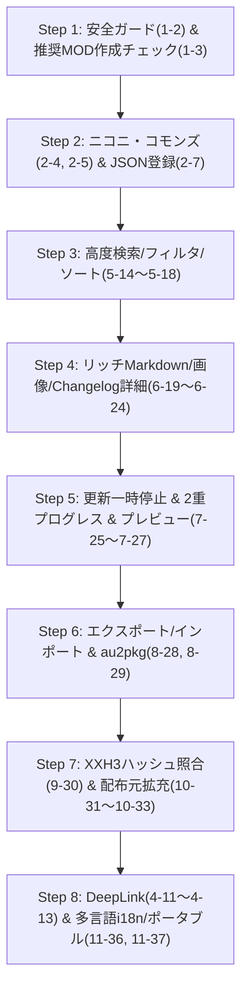

# Madoka-Launcher 機能拡張・完全実装計画（PLAN.md）

本計画書は、`aviutl2-catalog` に実装されている高度な機能群を、マルチソフト・マルチインスタンスランチャーである `Madoka`（Madoka-Launcher）へ移植・統合するための完全な実装ロードマップです。

---

## 1. 実装対象スコープの整理

ユーザー指定に基づき、以下のスコープで設計・実装を行います。

| カテゴリ | 機能番号 | 機能名 | 実装方針 | 状態 |
| :--- | :--- | :--- | :--- | :--- |
| **本体連携** | **1-2** | 本体起動中の安全ガード（実行中検知・ファイルロック防止） | **完全実装**（sysinfo / プロセス監視） | 完了 |
| | **1-3** | AviUtl2 推奨パッケージ（必須MOD）初期セットアップ | **完全実装**（新規作成画面にチェックボックス新設） | 完了 |
| | *1-1* | *メニューバー更新通知（UpdateChecker.aui2）* | *対象外（実装しない）* | 対象外 |
| **コモンズ連携** | **2-4** | ニコニ・コモンズ ID の一括集約・コピー画面 | **完全実装**（専用タブ / 一括コピー機能） | 完了 |
| | **2-5** | コモンズ ID 個別コピー＆登録ガイド導線 | **完全実装**（パッケージ詳細およびカード内導線） | 完了 |
| **開発者支援** | **2-7 / 3-7** | JSON 直接入力・パッケージ登録機能 | **完全実装**（マニフェストJSON直接インポート/テスト） | 完了(`index.json` 形式のエントリを解析し、ダウンロード・手順・ハッシュ検査の一覧を表示) |
| **外部連携** | **4-11** | カスタム URI スキーム（`madoka://`）の OS 登録 | **完全実装**（Deep Link ハンドラー） | 完了(IPC 受信時に最小化解除と前面化。IPC 往復テスト追加) |
| | **4-12** | Web リンクからのワンクリック自動インストール | **完全実装**（`?install=true` 処理） | 完了 |
| | **4-13** | 特定画面・インスタンスへのダイレクトジャンプ | **完全実装**（URL ルーティング処理） | 完了 |
| **検索・発見** | **5-14** | 多彩なソート順（人気・トレンド・新着・更新） | **完全実装**（ソートセレクターおよびアルゴリズム） | 完了(人気=カタログ内の被依存数、トレンド=直近90日のリリース数、新着=最古リリース日、更新=最新リリース日。外部の人気指標は使用しない) |
| | **5-15** | タグ（Tags）による絞り込み | **完全実装**（タグクラウド・トグル選択） | 完了 |
| | **5-16** | 導入状態フィルタ（すべて／導入済み／未導入） | **完全実装**（ステータスセグメントボタン） | 完了 |
| | **5-17** | 非推奨（Deprecated）フィルタ & 警告ダイアログ | **完全実装**（代替パッケージ案内含む） | 完了(導入時に非推奨メッセージ付き確認、詳細画面に警告カード) |
| | **5-18** | 検索・フィルタ・スクロール状態の完全復元 | **完全実装**（画面遷移時の State キャッシュ） | 完了 |
| **詳細画面** | **6-19** | 画像プレビュー & カルーセル（スライダー） | **完全実装**（画像ダウンロード＆カルーセル表示） | 完了(画像取得・表示、クリックで拡大) |
| | **6-20** | GitHub 互換 Markdown レンダラー | **完全実装**（アラート・テーブル・画像対応） | 完了(GFM アラート、テーブル、番号付きリスト、タスクリスト。画像は代替テキスト表示) |
| | **6-21** | 関連・前提パッケージ表示（Dependencies） | **完全実装**（前提条件チェック＆ジャンプ） | 完了 |
| | **6-22** | 作者名クリックでの検索ジャンプ | **完全実装**（作者フィルタリング連携） | 完了 |
| | **6-23** | ライセンス全文ダイアログ（MIT, CC0 等） | **完全実装**（テンプレート内蔵ダイアログ） | 完了 |
| | **6-24** | パッケージ個別更新履歴（Changelog）閲覧 | **完全実装**（バージョン別チェンジログ表示） | 完了 |
| **更新管理** | **7-25** | 更新の一時停止（バージョン固定・ピン留め） | **完全実装**（一括更新スキップ対象管理） | 完了 |
| | **7-26** | 更新前チェンジログ一覧プレビュー | **完全実装**（一括更新前の変更点サマリー確認） | 完了 |
| | **7-27** | アイテム別 & 全体の 2 重プログレス表示 | **完全実装**（全体％と個別MiB進捗の並行表示） | 完了 |
| **データ管理** | **8-28** | パッケージ構成のエクスポート & インポート | **完全実装**（構成JSON保存・一括復元） | 完了(取込時に `paused` を復元し、版の差異を通知。カタログは最新版のみ提供) |
| | **8-29** | 独自パッケージ形式（`.au2pkg`）の管理・登録 | **完全実装**（アーカイブ解凍・マニフェスト解析） | 完了(ドロップ受付、zip 列挙、ルート判定、Data 配下への配置、削除用記録) |
| **自動検出** | **9-30** | XXH3-128 ハッシュ照合による既存導入検出 | **完全実装**（高速ハッシュ計算による手動配置追跡） | 完了 |
| **配布元拡充**| **10-31** | Google Drive からの直接ダウンロード | **完全実装**（ウイルス警告ページバイパス） | 完了 |
| | **10-32** | BOOTH 配布パッケージの導入連携 | **完全実装**（外部ブラウザ／Webview連携） | 完了(WebView が永続プロファイルのセッションでファイルを保存し自動導入。実サイトでの動作は未確認) |
| | **10-33** | 特定開発者（rigaya 氏等）の独自配布対応 | **完全実装**（独自URL・リダイレクト処理） | 完了(`extractSfx` と `runAuoSetup` を解釈。実エントリでの動作は未確認) |
| **システム** | **11-36** | 多言語対応（i18n: 日/英/韓/簡中/繁中） | **完全実装**（言語リソース＆動的切り替え） | 完了(5 言語の辞書、設定画面の切替、起動時の OS 言語検出と保存) |
| | **11-37** | ポータブルモード切替 | **完全実装**（`data/` ローカル集約設定） | 完了(設定画面のスイッチで `data/` へ複製して切替。反映は再起動後) |

---

## 2. アーキテクチャと crate 構成の拡張

Madoka の既存 workspace 構造に沿って、各機能を適切に配置・分離します。

```mermaid
graph TD
    UI[launcher-app: GUI / Iced] --> CORE[launcher-core: データモデル & インスタンス]
    UI --> PROV[launcher-providers: カタログ & ダウンローダー]
    UI --> BROWSER[launcher-browser: WebView / ダウンロード]
    
    subgraph "新設・拡張モジュール"
        SYS[プロセス監視 & ポータブル管理 (core::process, core::portable)]
        HASH[XXH3-128 ハッシュスキャナー (core::hash)]
        NICONI[コモンズID集約 & エクスポート (core::niconi)]
        DEEP[DeepLink IPCサーバー/クライアント (app::deeplink)]
        I18N[多言語辞書エンジン (app::i18n)]
        DRIVE[Google Drive / BOOTH / rigaya ハンドラ (providers::downloaders)]
    end

    CORE --> SYS
    CORE --> HASH
    CORE --> NICONI
    PROV --> DRIVE
    UI --> DEEP
    UI --> I18N
```

### 追加する主な依存クレート
- `sysinfo = "0.33"`: プロセス監視・実行中検知（1-2用）
- `twox-hash = "2.1"` または `xxhash-rust = { version = "0.8", features = ["xxh3"] }`: XXH3-128 高速ハッシュ照合（9-30用）
- `pulldown-cmark = "0.13"`: Markdown 解析（6-20用）
- `interprocess = "2.2"`: 単一インスタンス制御 & DeepLink IPC 通信（4-11〜4-13用。`launcher-app` に導入済み）
- `rfd = "0.15"`: 構成ファイルの保存・選択ダイアログ（8-28用。`launcher-app` に導入済み）
- `image = "0.25"`: スクリーンショット・サムネイル画像のデコード/キャッシュ（6-19用）

---

## 3. 各機能の詳細実装設計

### フェーズ 1: 安全ガード & インスタンス作成（1-2, 1-3）

#### 【1-2】本体起動中の安全ガード
- **実装箇所**: `crates/launcher-core/src/process.rs`, `crates/launcher-app/src/screen/edit.rs`
- **設計**:
  - `Instance::is_running(&self) -> bool` メソッドを新設。
  - インスタンス種別（AviUtl2: `aviutl2.exe`, AviUtl: `aviutl.exe`, YMM4: `YukkuriMovieMaker.exe`）のプロセスが動作中かを `sysinfo` で判定。
  - プラグインの導入・更新・削除・一括更新ボタン押下時、プロセスが検知された場合はエラーダイアログ（「本体が起動中のため操作できません。終了してから再試行してください」）を表示して中断。

#### 【1-3】推奨パッケージ（必須MOD）初期セットアップチェックボックス
- **実装箇所**: `crates/launcher-app/src/screen/new_instance.rs`, `crates/launcher-app/src/app.rs`
- **設計**:
  - `new_instance::Form` に `install_recommended: bool` フィールドを追加。
  - `Kind::AviUtl2` 選択時のみ、フォーム上に「推奨プラグインを一括導入する（x264guiEx, L-SMASH-Works）」トグル/チェックボックスを表示（初期値: ON）。
  - インスタンス生成成功時、チェックが ON の場合は `setup.json` に定義された `corePackageId` (`Kenkun.AviUtlExEdit2`) および `requiredPluginIds` (`rigaya.x264guiEx`, `Mr-Ojii.L-SMASH-Works`) のインストールタスクを直ちにキューイングして自動導入。

---

### フェーズ 2: ニコニ・コモンズ & パッケージ登録（2-4, 2-5, 2-7 / 3-7）

#### 【2-4, 2-5】ニコニ・コモンズ ID 管理 & 個別コピー
- **実装箇所**: `crates/launcher-core/src/niconi.rs`, `crates/launcher-app/src/screen/edit.rs`
- **データモデル**:
  - `Package` 構造体に `pub niconi_commons_id: Option<String>` を追加。
- **UI 設計**:
  - インスタンス編集画面のタブに `Tab::NiconiCommons`（アイコン: `\u{e894}` または動画系アイコン）を追加。
  - インストール済みプラグインのうちコモンズ ID を持つものをリストアップ。
  - 「すべて選択」チェックボックスと「選択した ID をまとめてコピー（親作品登録用）」ボタン（改行区切りテキストをクリップボードに格納）。
  - 各行にコモンズ ID（例: `nc236081`）と「個別コピー」ボタン、コモンズ作品ページを開くリンクボタンを配置。

#### 【2-7 / 3-7】JSON 直接入力・パッケージ登録機能
- **実装箇所**: `crates/launcher-app/src/screen/edit.rs`, `crates/launcher-providers/src/catalog.rs`
- **設計**:
  - プラグインブラウズ画面に「マニフェスト JSON 直接登録 / テスト」ボタンを新設。
  - モーダルダイアログで JSON テキストエリアを表示し、検証・パース。
  - パッケージのダウンロード・展開テストをローカルでシミュレートし、配置予定ファイル一覧とログを表示。

---

### フェーズ 3: ディープリンク & 外部連携（4-11, 4-12, 4-13）

#### 【4-11 〜 4-13】DeepLink ハンドリング & 単一インスタンス制御
- **実装箇所**: `crates/launcher-app/src/deeplink.rs`, `crates/launcher-app/src/main.rs`
- **プロトコル登録**:
  - Windows: レジストリ `HKCU\Software\Classes\madoka` および `HKCU\Software\Classes\aviutl2-catalog`（互換用）に URL Protocol を登録。
  - Linux: `~/.local/share/applications/madoka.desktop` に `MimeType=x-scheme-handler/madoka;` を設定。
- **プロセス間通信（IPC）**:
  - `interprocess` によるローカルソケット（名前付きパイプ / UNIX ドメインソケット）サーバーを起動。
  - 2重起動時、起動引数の URL（例: `madoka://package/rigaya.x264guiEx?install=true`）を既存プロセスに送信して自身は終了。
- **URL ルーティング**:
  - `madoka://package/<id>`: 指定パッケージの詳細モーダルを開く。
  - `madoka://package/<id>?install=true`: 選択中のインスタンスに即時インストールを開始。
  - `madoka://updates`: アップデート一覧へジャンプ。

---

### フェーズ 4: 高度な検索・フィルタリング・並び替え（5-14 〜 5-18）

#### 【5-14 〜 5-17】ソート・タグ・導入状態・非推奨フィルタ
- **実装箇所**: `crates/launcher-app/src/screen/edit.rs` (Browse Tab)
- **ソート順**:
  - `Popularity`（人気順）、`Trend`（トレンド順）、`Newest`（新着順）、`Updated`（更新順）。
- **タグ機能**:
  - カタログ内全パッケージからユニークなタグ（例: `#入力プラグイン`, `#出力プラグイン`, `#スクリプト`）を抽出し、横スクロール可能なタグチップバーとして配置。複数タグの AND 絞り込みに対応。
- **導入状態フィルタ**:
  - 「すべて」「未導入」「導入済み」の 3 択セグメント。
- **非推奨（Deprecated）フィルタ & 警告**:
  - 非推奨フラグ（`deprecated: true`）のパッケージに赤色警告バッジを表示。
  - 詳細画面に「このプラグインは非推奨です。代替パッケージ: [〇〇]」を表示。

#### 【5-18】状態の完全復元（State Persistence）
- **設計**:
  - `edit::State` に `search_query`, `selected_tags`, `sort_order`, `install_status_filter`, `scroll_offset` を完全保持。
  - 詳細画面や別タブへ移動して戻った際、直前の検索条件・ソート順・スクロール位置へ瞬時に復帰。

---

### フェーズ 5: パッケージ詳細画面のリッチ化（6-19 〜 6-24）

#### 【6-19】画像プレビュー & カルーセル
- **設計**:
  - カタログデータの `screenshots: Vec<String>`（画像 URL 配列）を非同期取得。
  - 左右送りボタン付きのカルーセルコンポーネントを配置し、クリックで拡大プレビュー。

#### 【6-20】GitHub 互換 Markdown レンダラー
- **設計**:
  - `pulldown-cmark` で Markdown をパースし、Iced の UI ウィジェットツリー（Column / Row / Text / Card）へ変換。
  - GitHub Alerts（`[!NOTE]`, `[!TIP]`, `[!IMPORTANT]`, `[!WARNING]`, `[!CAUTION]`）を適切なアクセントカラーの Card に変換。
  - コードブロック、インラインコード、リンク、引用、リストを美しくレンダリング。

#### 【6-21 〜 6-24】依存関係、作者ジャンプ、ライセンス、Changelog
- **依存関係（6-21）**: `dependencies: Vec<String>` を一覧化し、前提プラグインへのワンクリックジャンプボタンを設置。
- **作者名ジャンプ（6-22）**: 作者名をクリックすると、自動で作者名検索がセットされて一覧へ遷移。
- **ライセンス全文（6-23）**: MIT, CC0, GPL 等のライセンス全文ポップアップ表示。
- **更新履歴（6-24）**: バージョンごとの更新内容リスト（Changelog）タブの設置。

---

### フェーズ 6: アップデート管理の高度化（7-25 〜 7-27）

#### 【7-25】更新の一時停止（ピン留め・スキップ）
- **設計**:
  - `InstanceConfig` 内のプラグインレコードに `pub paused: bool` フラグを追加。
  - パッケージ行に「更新を保留（ピン留め）」スイッチを配置。保留中は一括更新の対象から除外。

#### 【7-26】更新前チェンジログ一覧プレビュー
- **設計**:
  - 「すべて更新」ボタン押下時、即座に実行するのではなく「更新サマリーダイアログ」を表示。
  - 更新予定の全パッケージ名、旧バージョン → 新バージョン、および Changelog（変更点）の箇条書きを一覧プレビュー。確認後に一括実行。

#### 【7-27】2 重プログレス表示
- **設計**:
  - タスク画面および更新画面に、全体進捗（例: `3/8 パッケージ完了 (37%)`）バーと、現在処理中パッケージの個別転送量（例: `14.2 / 20.0 MiB (71%)`）バーを上下 2 段でリアルタイム描画。

---

### フェーズ 7: データ管理・バックアップ & au2pkg（8-28, 8-29）

#### 【8-28】パッケージ構成のエクスポート & インポート
- **設計**:
  - インスタンス内のプラグイン構成を `madoka-packages.json` としてファイル出力（保存ダイアログ）。
  - 別のインスタンスで「構成をインポート」を実行すると、不足しているプラグインをカタログから自動探索して一括インストール。

#### 【8-29】`.au2pkg` 形式のサポート
- **設計**:
  - `.au2pkg`（または `.zip`）ファイルのドラッグ＆ドロップ対応。
  - アーカイブ内のマニフェストファイル（`package.json` や配置スクリプト）を読み取り、適切なディレクトリへ自動配置・管理。

---

### フェーズ 8: ハッシュ照合・自動検出（9-30）

#### 【9-30】XXH3-128 ハッシュによる手動導入プラグインの自動照合
- **実装箇所**: `crates/launcher-core/src/hash.rs`
- **設計**:
  - `scan_xxh3_128(app_dir)`: `app/` 配下の `Plugin`・`Plugins`・`Script`・`Scripts` をサブディレクトリまで走査し、XXH3-128 をスレッド並列で計算。
  - `is_present(app_dir, checks, scanned)`: レシピの `checks` が空でなく、全 check が成立するとき導入済みと判定。check は「記録パスのファイルのハッシュ一致」または「XXH3-128 の値が走査結果に存在（移動済み）」で成立。
  - 判定に成功したパッケージを `PluginRecord` として登録し、更新追跡の対象にする。

---

### フェーズ 9: ダウンロード元の拡充（10-31 〜 10-33）

#### 【10-31 〜 10-33】Google Drive, BOOTH, 独自配布対応
- **Google Drive（10-31）**:
  - `drive.google.com/uc?export=download&id=...` の大容量確認画面（`confirm=t`）を自動検出し、クッキー・トークンを引き継いで本番ファイルをストリーミングダウンロード。
- **BOOTH 連携（10-32）**:
  - BOOTH のログイン・要認証ダウンロードに対応するため、`launcher-browser` の WebView セッションを活用し、ダウンロードリンクを捕捉して自動導入。
- **独自配布（10-33）**:
  - rigaya 氏の配布サイト等の独自リダイレクトや HTML スクレイピングダウンローダーを `launcher-providers` に追加。

---

### フェーズ 10: 多言語 i18n & ポータブルモード（11-36, 11-37）

#### 【11-36】多言語対応（i18n）
- **設計**:
  - `crates/launcher-app/src/i18n/` モジュールを新設。
  - 言語定義: 日本語 (`ja`), 英語 (`en`), 韓国語 (`ko`), 簡体字中国語 (`zh-CN`), 繁体字中国語 (`zh-TW`)。
  - 設定画面で言語をリアルタイム切り替え可能に。

#### 【11-37】ポータブルモード切替
- **設計**:
  - アプリ実行ファイルと同じ階層に `data/` フォルダが存在するか、または設定で「ポータブルモード」が有効化された場合、`~/.local/share` 等ではなくローカルディレクトリ内に全設定・インスタンス・キャッシュを格納。

---

## 4. 実装ステップとスケジュール



---

## 5. テスト・品質保証計画

1. **単体テスト（Unit Tests）**:
   - XXH3-128 ハッシュ照合の正確性テスト
   - Markdown パーサーのタグ・アラート抽出テスト
   - Google Drive URL 正規化・トークン抽出テスト
   - ニコニ・コモンズ ID 抽出・整形テスト
2. **プロセス監視・安全ガードテスト**:
   - ダミープロセス起動下でのプラグイン更新ブロック検証
3. **Deep Link 検証**:
   - 外部ブラウザから `madoka://` を叩いた際の IPC 受信とウィンドウ前面化テスト
4. **Clippy & フォーマット**:
   - `cargo clippy --workspace --all-targets` (all = deny) の完全通過
   - 既存コード規約との整合性確認

---

## 6. 残作業

| 項目 | 内容 | 変更箇所 |
| :--- | :--- | :--- |
| 動作確認 | 実機で 5-18 の `scroll_to`、10-32 の BOOTH ログイン維持とダウンロード保存、10-33 の `runAuoSetup` を確認 | - |
| 上流スキーマ | 上流は `meta/content/install/versions` 形式の配布スキーマへ移行済み。`index.json` が同形式を維持するか確認 | `launcher-providers/src/aviutl2.rs` |

PLAN.md の「完了」表記 38 項目のうち、コード上の欠陥 9 件、記載との差異 14 件を確認した。ビルドと実行はしていない。判定はソース読解のみによる。

## A. 修正済み項目（ソース読解のみ。ビルドと実行は未実施）

| # | 機能 | 修正 | 箇所 |
|---|---|---|---|
| 1 | 4-12 | `pending_install` を保持し、`CatalogLoaded` 後に `Install` を送信 | `app.rs`, `edit.rs` |
| 2 | 9-30 | `Root::Data` を判定。走査対象に `app/data/{Plugin,Plugins,Script,Scripts}` を追加 | `hash.rs` |
| 2a | 9-30 | 記録パスを instance の `app_dir` 相対へ変換 | `ops.rs` |
| 3 | 7-26 | 差分 0 件のとき `update_all` を直接実行 | `app.rs` |
| 4 | カタログ | 編集画面を開く時と任意タブ選択時に読込 | `app.rs` |
| 5 | 2-7 | 登録済みマニフェストを `State.registered` に保持し、読込結果へ統合 | `edit.rs`, `app.rs` |
| 6 | 1-3 | `Created` で `pending_recommended` を常に解除 | `app.rs` |
| 7 | 10-32 | 未対応ファイルを `OpError::Unsupported` で失敗扱い | `ops.rs` |
| 8 | 6-22 | `AuthorSelected` で検索設定と `viewing_package_id` 解除を同時実行 | `edit.rs`, `app.rs` |
| 9 | 6-23 | `licenses` を文字列・オブジェクトの両形式で受理。`License { name, body }` 新設。条文8種を `launcher-providers/assets/licenses/` に同梱。ダイアログを一覧の上段へ移動 | `catalog.rs`, `aviutl2.rs`, `edit.rs` |

## B. PLAN 記載との差異

| 項目 | 差異 |
|---|---|
| 1-2 | ガード対象外の操作: `ConfigImported`、`FileDropped`、`Duplicate`。`is_running()` が `Scrolled` を含む全メッセージで実行され、毎回プロセス走査が発生する。 |
| 1-3 | `setup.json` を読まず、ID 2 件を `app.rs` に直書きしている。 |
| 2-5 | 詳細画面とカード内のコモンズ ID はチップ表示のみ。コピー操作と登録ガイド導線がない。 |
| 4-11 | URL なしの二重起動は転送されず、別プロセスが起動する。ID をパーセントデコードしない。 |
| 4-13 | ルートは `package/<id>` と `updates` のみ。インスタンス指定がない。`updates` はランチャー更新の確認画面で、プラグイン更新一覧ではない。 |
| 5-17 | 代替案内は `deprecation_message` の文字列のみ。`OpenInBrowser` の経路は確認ダイアログなし。 |
| 5-18 | State は編集画面を離れると破棄される。復元範囲は編集画面内のタブと詳細画面のみ。 |
| 6-20 | リンク、強調、取り消し線、HTML を描画しない。 |
| 6-21 | 依存パッケージの導入状態表示、未導入警告がない。カタログにない ID は押しても反応しない。 |
| 6-24 / 7-26 | changelog は未分割の 1 文字列。版範囲の抽出がない。詳細画面は Markdown を描画しない。 |
| 8-28 | `restore_config` は `is_verified()` を確認せずに導入する。 |
| 8-29 | PLAN 本文はマニフェスト読取。実装はルート名判定のみ。`.zip` 全般を受理する。 |
| 10-31 | Cookie 引継ぎは未実装（reqwest の cookies feature なし）。confirm フォームの入力で代替している。 |
| 10-33 | `auo_setup2` が書くファイルは `files` と rollback の対象外。 |
| 11-36 | 未翻訳の文字列: `by {author}`、`ID:`、`Unknown`、アラート名（NOTE など）。 |
| 11-37 | `./data`（cwd）で有効な場合、`is_portable()` が `false` になる。複製は TaskBoard に載らず、進捗表示がない。 |

## C. PLAN 本文と実装の位置の不一致（PLAN 側の修正対象）

| PLAN の記載 | 実装 |
|---|---|
| `core/process.rs` | `runner.rs`（`is_instance_running`） |
| `core/niconi.rs`、`Tab::NiconiCommons` | ファイルなし。`catalog.rs` の `niconi_commons_id` と `Tab::Commons` |
| `providers/catalog.rs` | `aviutl2.rs`（`parse_aviutl2_manifest`） |
| `app/i18n/` ディレクトリ | `i18n.rs` |
| `core::portable` | `paths.rs` |
| 依存 `sysinfo 0.33`、`rfd 0.15`、`interprocess 2.2` | `0.40`、`0.17`、`2` |
| 依存 `image 0.25`、`twox-hash` | 未使用（画像は iced の `image` feature） |

孤立ファイル: `screen/menu_bar.rs`。`mod.rs` に未登録で、`iced_aw` に依存せず、存在しない `style::theme_groups` を参照している。削除対象。

## D. 残作業

- **実機確認 3 件**: 5-18 の `scroll_to`、10-32 の BOOTH ログイン維持と保存、10-33 の `runAuoSetup`。
- **ビルド確認**: A の 10 件は `cargo clippy --workspace --all-targets` と `cargo test --workspace` を未実行。
- **上流スキーマ**: `aviutl2-catalog` は `manifest / list / detail / versions / install` 形式（`schemaVersion`）を使用する。`index.json` の実形式は未取得。`licenses` は文字列・オブジェクトの両形式を受理済み。
- **9-30 制約**: 移動済みファイルを検出した場合、記録パスは配布時のパスで、実ファイルは削除対象にならない。

## E. テスト計画（PLAN §5）の未実装

- コモンズ ID の抽出・整形
- `is_instance_running` と安全ガード
- deeplink から導入までの結合
- `restore_config`
- AviUtl2 構成での `scan_and_register_manual_plugins`
- 5 言語の yml のキー集合一致

次の作業は、A の 9 件の修正から着手する。作業指示が必要であれば、A の番号で指定すること。

Sources: [aviutl2-cli catalog_schema.rs](https://docs.rs/crate/aviutl2-cli/0.9.0-preview.0/source/src/catalog_schema.rs), [aviutl2-cli e2e.rs](https://docs.rs/crate/aviutl2-cli/0.8.3/source/tests/e2e.rs)