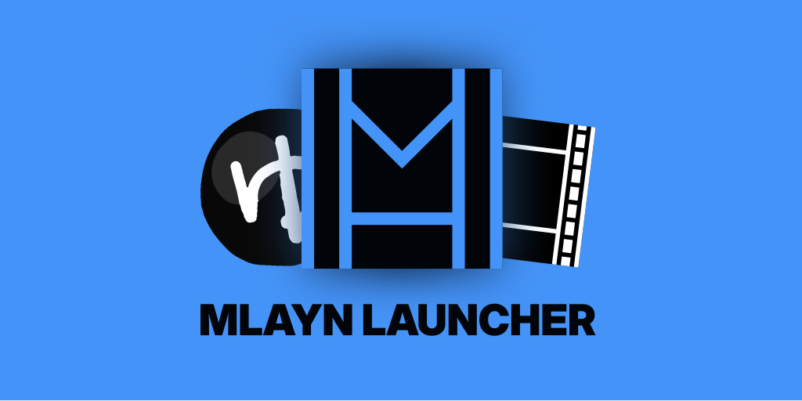

# MLAYN Launcher とは

YMM4 / AviUtl 専用の、バージョン・プラグイン・インスタンス管理アプリです。

動画編集ソフト本体及び拡張プラグインのダウンロードと整理を簡単に行えます。

MLAYN Launcher は完全無料・自由・オープンソースです。広告やトラッキング等は一切ありません。

類似の他アプリとの違いは以下の通りです。
- 複数の動画編集ソフトに対応
- 複数のインスタンスの管理に対応
- 他アプリからのインポートに対応

# 対応ソフト

| | ゆっくりMovieMaker 4 | ゆっくりMovieMaker 4 Lite | AviUtl ExEdit0 | AviUtl ExEdit2 | NeoUtl | AviQtl Plus |
| --- | --- | --- | --- | --- | --- | --- |
| **バージョン管理** | ✅️ | ✅️ | ✅️ | ✅️ | ✅️ | ✅️ |
| **インスタンス管理** | ✅️ | ✅️ | ✅️ | ✅️ | ✅️ | ✅️ |
| **プラグイン管理** | ✅️（[饅頭遣いのおもちゃ箱](https://manjubox.net/ymm4/)参照） | ✅️（[饅頭遣いのおもちゃ箱](https://manjubox.net/ymm4/)参照） | ✅️（[apm-data](https://github.com/team-apm/apm-data) 参照） | ✅️（[aviutl2-catalog-data](https://github.com/Neosku/aviutl2-catalog-data) 参照） | ❌️ | ❌️ |

# ダウンロード・インストール

[mlayn.org](https://mlayn.org) から MLAYN Launcher を入手できます。

Windows11 及び Linux に対応しています。

# よくある質問

MLAYN Launcher は ゆっくりMovieMaker や AviUtl の公式ですか？

いいえ。MLAYN チームは ゆっくりMovieMaker や AviUtl とは直接関係のない、有志による非営利チームです。

「MLAYN」とは？

「**M**od **L**oader for **A**viUtl, **Y**ukkuriMovieMaker, and **N**eoUtl」の略です。

MLAYN の最終目標は、AviUtl 、ゆっくりMovieMaker 、NeoUtl 等で動作する MOD ローダーを開発することです。

これらの動画編集ソフトはお互いに遠い親戚みたいなものですが、それぞれの仕組みが一切異なる為に、プラグイン等のコミュニティ資産を共有できない、という課題があります。

MLAYN は、WASM や WIT 等と言った技術を用いた汎用プラグイン規格・ホストを実装しています。

これにより、プラグイン開発者は、一度プラグインを書き、ビルドするだけで、複数の動画編集ソフト、複数の OS に、同時に対応することが出来ます。又、C++ や C# 等以外の使い慣れた言語で開発することが可能になります。

MLAYN Mod Loader は、現在は非公開で開発されています。

MLAYN Launcher は、MLAYN プロジェクトの「始めの一歩」となります。

